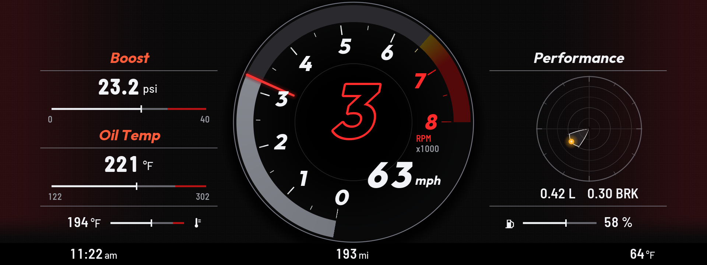
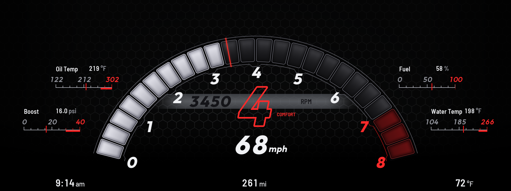

# Cluster Themes

Redraws the whole instrument cluster in a theme of your choice. Open **Cluster Themes** from the apps menu on the center screen: its own page has the themes with pictures, the readouts, the badge, the Waze map, warnings and settings.

## Themes

Every theme fills the cluster and shows its own clock, range and outside temperature along the bottom, in the theme's style. Only BMW's gear letter at the bottom right stays uncovered: when a theme covers it, BMW draws a black box over the theme (issue #5). Every theme shows the drive mode (Comfort, Sport and so on) next to the gear. On M cars and some others, like the G22 4 Series, BMW still draws two boxes; turn on Leave BMW's bottom strip clear and the theme ends just above BMW's strip, which then shows BMW's own clock, range and outside temperature.

### Apex

A needle dash in a mid-engine supercar style, on a carbon backdrop with a muted red glow at the sides.

- **Middle:** a round rev counter, 0 to 8000 rpm, its band lit grey up to the revs, amber from 6500 rpm and red from 7000, with a red needle. The gear is a hollow red italic in the middle with the drive mode under it; the speed sits in the open quarter at the bottom right, in a bold italic with its unit.
- **Left:** boost (0 to 40 psi, red from 30) and oil temperature, each a value over a line bar with a marker, its range and a red end zone.
- **Right:** a G-meter under a Performance heading, with the side and fore-aft g under it.
- **Background** (Settings): the red glow at the sides (default), or carbon twill lit from the tach out to the sides, with a deeper drop shadow round the tach.
- **Tach response** (Settings): Quick (default), Instant, Smooth like BMW's own tach, or Predictive: the car sends the revs about 10 times a second, and between readings the needle carries on at the rate the last two showed (at most 120 ms and 500 rpm ahead), so it keeps up with the engine instead of trailing a reading behind.
- **Left side** (Settings): Bars (default), or Gauges: the heading and value on one row over a slanted gauge with a tick scale and a red needle; Gauge fill makes it striped (default) or solid.
- **Gear** (Settings): the gear outlined (default) or solid, in red.
- **Gear display** (Settings): from the gearbox (BMW's signal, default), or Quick: worked out from speed and revs once the app has learnt your gears over a few minutes of driving, so it changes the moment you shift.
- **Speed in the tach** (Settings, on by default): turn it off to leave the open quarter of the tach empty.
- **Readings check** (Settings, off by default): the status line on the app's page shows how many times a second the car sends rpm, speed, gear and boost, and where boost comes from.
- **Glow round the gear** (Settings, off by default): a soft red or white glow fading outward from the ring round the gear.
- **Bottom:** coolant and fuel as small bars, and under them the clock, range and outside temperature, with BMW's own gear letter.

Apex has no map window; with "Show Waze map inside the theme" on, Waze stays in its usual place. The layout is made by `tools/gen_apex.py`.

### Veloce

An Italian supercar style dash on a dark hex-cell backdrop.

- **Top:** a wide arc of rounded tiles, 0 to 8000 rpm, three to each thousand. The tiles light pale silver up to the revs, with a thin red needle across them at the exact rpm. From 7000 rpm the tiles are a muted red that glows when lit, and the arc's inner rail turns red.
- **Middle:** the gear big and hollow in red over a grey band, with the rpm in digits on the band and the drive mode beside the gear. The speed sits under it in a bold italic with its unit.
- **Sides:** four small scales stepped along the arc, each with its name and value above it, italic min / middle / max numbers and a red needle: oil temperature and boost on the left, fuel and coolant on the right. The car doesn't send oil pressure, so boost takes its place.
- **Bottom:** the clock, range and outside temperature, with BMW's own gear letter.

Veloce has no map window; with "Show Waze map inside the theme" on, Waze stays in its usual place. The layout is made by `tools/gen_veloce.py`.

## Starting with the car

Since 0.22.0 the app starts by itself when the head unit powers up (autostart), without its page, and draws the cluster from then on; opening it from the apps menu shows the page over that same drawing. If the head unit starts a second copy when the page is opened, the older one stops drawing (data/running.json) so the cluster is drawn once.

## Off and drive modes

- **Off (BMW's own cluster):** pick it as the theme and the app draws nothing, so BMW's cluster comes back.
- **Change with SPORT / COMFORT / ECO PRO** (on by default): the cluster follows the drive mode buttons, with a theme for each mode. Out of the box, every mode shows Apex; pick Off for a mode to get BMW's own cluster there. Until the car reports a mode, the plain theme setting is used.
- **M cars:** Efficient, Sport and Sport+ from M Setup switch the theme too.
- **Plug-in hybrids:** Sport and Sport Plus switch to your Sport theme; Hybrid, Electric and Battery Control count as Comfort, and Hybrid Eco Pro as Eco Pro.
- **With HUD Widgets:** on cluster-render 0.5.1 and newer, a cluster theme and a HUD layout show at the same time. On older cluster-render they share one screen slot and take turns: pick a theme while the HUD is on and the page asks whether to turn HUD Widgets off, and it asks the same the other way round.

## Settings

- **Theme**, and one per drive mode.
- **Readouts:** pick which car sensor each GT3, M, Track, Drag, Rally, Retro 80s or Dyno readout shows (speed, rpm, boost, temperatures, tyres, fuel, g, power and more). Plug-in hybrids can also show **Hybrid battery**, the high-voltage battery's charge in % (not yet checked on a hybrid).
- **Show Waze map inside the theme:** GT3, Sport and M open a window in the middle and Waze on Cluster draws its map in it, above BMW's own map view, so nothing shows twice. When the map goes away the theme fills back in. While it is on, Waze's map on the HUD is off. Needs robertnisipeanu's Waze on Cluster; turning it off gives Waze its usual place back.
- **Badge:** the model name, like "BMW X3 M40i", as text in the theme's font (GT3 top left, Sport, M and Minimal top centre, where BMW puts its own). Off by default.
- **Warnings:** oil, coolant and boost limits. A readout over its limit flashes red (oil 130°C and coolant 115°C by default, boost off).
- **Test the shift lights:** runs the rpm up to the shift point for about 4 seconds while the car stands.
- **Play demo:** the button at the top of the page plays a 60-second show on the cluster while the car stands (a pull through the gears with graded shifts, the limiter, braking, corners, boost, the oil warning once), with a DEMO tag. It stops at the end, on Stop, or as soon as the car moves, and nothing from it is kept.
- **Shift lights:** Count in (the default) fills the lights over about the last second before the shift point and flashes early by your reaction time; Fixed rpm band works as before. Ported from Redline (MIT).
- **Temperatures only when they matter** (off by default): oil and coolant turn blue while cold, yellow while warming, red over their limit; the outside temperature turns blue at 3°C (37°F) and under.
- **Night colours:** after sunset the theme's whites and greys dim to 60% (Auto, the default), or Off.
- **Units:** mph, °F, psi or km/h, °C, bar. **Temperature** and **Pressure** can be set on their own (°C or °F, bar or psi), for example mph with °C and psi; Match speed (the default) follows Units.
- **Clock:** 12-hour or 24-hour.
- **Time zone (clock):** the head unit's clock runs on UTC, so pick your zone once. Named zones (US Eastern, Central, Mountain, Pacific, Alaska, Hawaii, Arizona, Canada Atlantic, Mexico, UK / Ireland / Portugal, Central Europe, Eastern Europe) change for daylight saving by themselves; for anywhere else, pick your offset from UTC. Night colours uses the same zone to work out sunset.
- **Fuel tank size:** the fuel gauge asks the engine unit for the level in %. Where the engine unit doesn't answer, it works it out from the litres the car reports and this size (65 L on an X3, 59 L on a 3 Series).
- **Redline:** where the red marks start on the rev scales (they always cover at least the last 500 rpm, and the yellow marks sit in the 700 rpm before them).
- **Shift point before redline:** how far below the redline the shift lights peak (300 rpm by default).
- **Cold-engine rev guard:** until the oil reaches 80°C, the shift point starts at 4500 rpm and climbs as the oil warms up.
- **Show boost.**
- **Leave room for the driver camera** (off by default): for newer cars with a driver attention camera in the top middle of the cluster, where other cars show the model badge. The shift lights and rev bars (GT3, Track, Dyno, Rally) become two mirrored wings either side of the camera that fill from the outer ends in towards it and meet at the shift point, Track's rpm numbers are left out, M's logo is hidden, and Ribbon's ribbon dips under the camera instead. The camera's spot is taken from where the badge sits on a car without one. Not yet tested on a car with a camera; please report how it lines up on yours.
- **Leave BMW's bottom strip clear** (off by default): for cars where BMW draws black boxes over the theme even with its gear letter uncovered (M cars, the G22 4 Series). The theme ends just above BMW's bottom strip and BMW's own clock, range and outside temperature show there instead of the theme's. Nothing is squeezed.
- **Holiday editions:** a string of glowing holiday lights along the top of every theme, and Ribbon's own holiday edition. Auto (the default) puts them on by the date: Thanksgiving in its week (Monday to Sunday), Christmas from December 1 to 26, New Year from December 27 to January 2, and the Fourth of July from July 1 to 5, then takes them off again. Or pick one holiday to keep it on, or Off. The date follows the Time zone (clock) setting.
- **G-meter** (its own tab): the range (0.8, 1.0, 1.2, 1.5 or 2.0 g at the edge; 1.2 by default), the trail (off, 1, 2 or 4 seconds), **Swap left / right** (if the dot goes the wrong way in a turn) and **Brake on top**, the best left, right, accelerating, braking and overall g of the drive with a Reset button, and a live copy of the meter. The g comes from the car's own acceleration sensor: parked on level ground it reads 0.00, and a hill adds a little.
- **Demo data:** fake driving data for trying it out parked. It switches back to the car's own data as soon as the car moves faster than 5 km/h.
- **Calibration grid:** a theme that draws lines every 50 px with labels, for checking on a photo where things land on the real screen. It also carries a few test marks used to measure cluster-render's limits on the car.
- **Map calibration:** a theme that leaves BMW's whole map window open with a grid through it, for photographing exactly what shows through the map cut-out with a navigation map up.

**Shift grades:** every upshift is graded on its peak rpm. EARLY means more than 250 rpm under the shift point, LATE more than 200 over it, COLD REV the same while the cold guard is on, LIMITER within 25 rpm of the redline, and anything in between is SPOT ON. Only shifts aimed at the shift point are graded: one more than 1500 rpm under it (an everyday shift) or one the gearbox made itself in D or S is left out, and the last grade stays on screen. When Redline 2.0.28 or newer is running, the shift point and the grade come from Redline, which learns a shift point for each gear.

## Requirements

[cluster-render](https://github.com/robertnisipeanu/idrive-apps), installed from the `robertnisipeanu/idrive-apps` Store source. Version 0.5.1 or newer lets the theme show together with HUD Widgets.

## On the car

Tested on a 2020 X3 M40i. Checked on the car: GT3 and Dyno draw complete, the Waze map shows inside GT3 and Sport, and a theme and a HUD layout show together. Still to be checked:

- the other themes on the real screen, including M since its 0.10.0 rework;
- whether BMW's warning lights still show over the dash (start the car with a seat belt off and look);
- the clock with a named time zone, and the fuel % from the engine unit;
- the Hybrid battery readout on a plug-in hybrid;
- Play demo, the count-in shift lights and the switch-off guard (0.16.0).

If something looks wrong on your car, the last line of the Settings tab says what the app is doing and why anything is not drawn. Please open an issue with it.

See [Use at your own risk](../../README.md#use-at-your-own-risk) before installing.

Version history is in the repo's [CHANGELOG.md](../../CHANGELOG.md).
